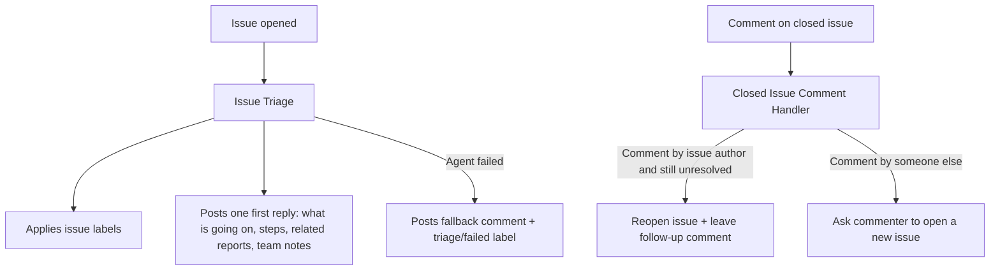
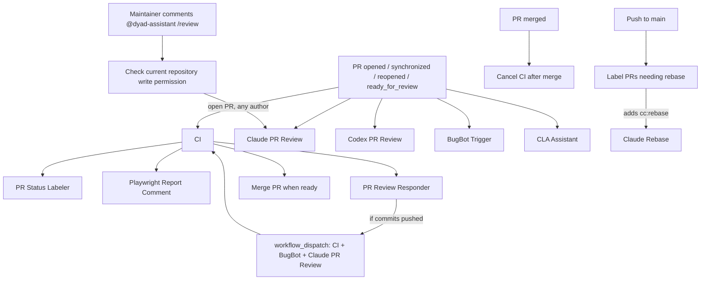

# GitHub Workflows Overview

This directory contains CI/CD, automation, triage, and release workflows.

## Issue Workflow Relationships



## PR Workflow Relationships



## Workflows

| File                              | Name                           | Description                                                                                                                                                                                                                                 | Trigger                                                                                                              | Output labels                                                                                                                                                                                       |
| --------------------------------- | ------------------------------ | ------------------------------------------------------------------------------------------------------------------------------------------------------------------------------------------------------------------------------------------- | -------------------------------------------------------------------------------------------------------------------- | --------------------------------------------------------------------------------------------------------------------------------------------------------------------------------------------------- |
| `bugbot-trigger.yml`              | `BugBot Trigger`               | Posts `@BugBot run` on eligible PRs so BugBot starts a review.                                                                                                                                                                              | `pull_request_target` on `opened/synchronize/ready_for_review/reopened`; or `workflow_dispatch` with `pr_number`.    | None.                                                                                                                                                                                               |
| `cancel-ci-after-merge.yml`       | `Cancel CI after merge`        | Cancels still-running or queued `CI` runs for a PR commit after merge.                                                                                                                                                                      | `pull_request` on `closed` (only when merged).                                                                       | None.                                                                                                                                                                                               |
| `ci.yml`                          | `CI`                           | Runs presubmit checks, type checks, unit tests, build, and Playwright E2E/report merge.                                                                                                                                                     | `push` to `main`; `pull_request` on `opened/synchronize/reopened/closed`; or `workflow_dispatch` with `pr_number`.   | None.                                                                                                                                                                                               |
| `cla.yml`                         | `CLA Assistant`                | Verifies/signs contributor CLA status on PR events and specific comment commands.                                                                                                                                                           | `pull_request_target` on `opened/closed/synchronize`; plus `issue_comment` on `created` for `recheck` or CLA phrase. | No repository-specific labels set in this file.                                                                                                                                                     |
| `claude-deflake-e2e.yml`          | `Claude Deflake E2E`           | Runs an AI-assisted deflake routine over recent PR E2E failures.                                                                                                                                                                            | Daily cron (`0 10 * * *`) or `workflow_dispatch` (`pr_count`).                                                       | None.                                                                                                                                                                                               |
| `claude-pr-review.yml`            | `Claude PR Review`             | Static review of allowed-author PRs, or any open PR on a maintainer request.                                                                                                                                                                | PR events for allowed authors; new PR comments containing only `@dyad-assistant /review`.                            | None.                                                                                                                                                                                               |
| `claude-pr-review-run.yml`        | `Claude PR Review Execution`   | Runs static review and posts validated artifacts under one PR-wide concurrency lock acquired by the caller after authorization.                                                                                                             | Reusable workflow called by `claude-pr-review.yml`.                                                                  | None.                                                                                                                                                                                               |
| `claude-windows-pr-review.yml`    | `Claude Windows PR Review`     | Reviews cross-platform compatibility on Windows Server 2022, executing the exact PR head with shell access and posting validated summary/inline findings in a separate job. Uses the existing reviewer author allowlist.                    | `pull_request_target` on `opened/synchronize/ready_for_review/reopened/closed`.                                      | None.                                                                                                                                                                                               |
| `claude-rebase.yml`               | `Claude Rebase`                | Rebases an allowed-author PR after it is explicitly flagged for rebase.                                                                                                                                                                     | `pull_request_target` on `labeled` (only label `cc:rebase`).                                                         | `cc:rebase` -> `cc:rebasing` while running; removes `cc:rebasing` on success; adds `cc:rebase-failed` on failure.                                                                                   |
| `claude-triage.yml`               | `Issue Triage`                 | Uses Claude to label new issues, write one reporter-facing first reply (what is going on, steps to try, related reports, what to send us, notes for the team), and replace blank titles. Posts a short fallback comment if the agent fails. | `issues` on `opened`.                                                                                                | Adds one of `bug` / `feature request` / `ux/usability`, and may add `pro`, `issue/lang`, `issue/incomplete`, `triage/needs-human`. Adds `triage/failed` when the agent produced no usable decision. |
| `codex-pr-review.yml`             | `Codex PR Review`              | Runs Codex CLI against a trusted PR context, validates findings, and posts summary plus inline review comments.                                                                                                                             | `pull_request_target` on `opened/synchronize/ready_for_review/reopened/closed` for allowed authors.                  | None.                                                                                                                                                                                               |
| `close-stale-prs.yml`             | `Close stale PRs`              | Closes PRs older than two months and leaves an explanatory comment.                                                                                                                                                                         | Daily cron (`0 0 * * *`) or `workflow_dispatch`.                                                                     | None.                                                                                                                                                                                               |
| `closed-issue-comment.yml`        | `Closed Issue Comment Handler` | Handles new comments on closed issues and can reopen/respond based on intent.                                                                                                                                                               | `issue_comment` on `created` (closed issues only, not PRs).                                                          | None.                                                                                                                                                                                               |
| `draft-stale-prs.yml`             | `Draft stale PRs`              | Converts inactive open PRs to draft after 7 days without meaningful activity.                                                                                                                                                               | Daily cron (`0 0 * * *`) or `workflow_dispatch`.                                                                     | None.                                                                                                                                                                                               |
| `label-rebase-prs.yml`            | `Label PRs needing rebase`     | Finds conflicting open PRs from allowed authors and flags them for rebase.                                                                                                                                                                  | `push` to `main`.                                                                                                    | Adds `cc:rebase` when eligible PR is conflicted (`mergeable_state == dirty`) and not already in rebase states.                                                                                      |
| `merge-pr.yml`                    | `Merge PR when ready`          | Auto-merges eligible PRs after successful CI when all checks pass.                                                                                                                                                                          | `workflow_run` for `CI` on `completed` (successful PR-triggered CI only).                                            | None (reads `merge-when-ready`, does not set labels).                                                                                                                                               |
| `nightly-runner-cleanup.yml`      | `Nightly Runner Cleanup`       | Safely frees disk space on self-hosted macOS runners ci1-ci4 (caches, npm, runner \_work), then reboots them.                                                                                                                               | Daily cron (`0 12 * * *`, 4 AM PST / 5 AM PDT); or `workflow_dispatch`.                                              | None.                                                                                                                                                                                               |
| `playwright-comment.yml`          | `Playwright Report Comment`    | Posts a Playwright summary comment on the PR tied to a completed CI run.                                                                                                                                                                    | `workflow_run` for `CI` on `completed`.                                                                              | None.                                                                                                                                                                                               |
| `pr-review-responder.yml`         | `PR Review Responder`          | Runs Claude fix loops for trusted PRs, retriggers checks/reviews, and advances request-state labels.                                                                                                                                        | `pull_request_target` on `labeled` (only `cc:request:now`); `workflow_run` for `CI` on `completed`.                  | `cc:request`/`cc:request:N` -> `cc:pending`; then `cc:request:N+1` on pushed commits, `cc:done` on clean finish, `cc:failed` on failure; may add `needs-human:review-issue` when retries exhausted. |
| `pr-status-labeler.yml`           | `PR Status Labeler`            | Applies human-attention labels based on CI outcome and review freshness/verdict.                                                                                                                                                            | `workflow_run` for `CI` on `completed`.                                                                              | Swaps between `needs-human:final-check` (clean + passing) and `needs-human:review-issue` (failing/stale/missing/issueful review).                                                                   |
| `release.yml`                     | `Release app`                  | Manually builds and publishes signed release artifacts across platforms, then verifies assets.                                                                                                                                              | `workflow_dispatch`.                                                                                                 | None.                                                                                                                                                                                               |
| `remove-unauthorized-release.yml` | `Remove Unauthorized Release`  | Deletes published releases not authored by `github-actions[bot]`, then emails maintainers with the outcome.                                                                                                                                 | `release` on `published`.                                                                                            | None.                                                                                                                                                                                               |

## Nightly Runner Cleanup

The `nightly-runner-cleanup.yml` workflow runs at 12:00 UTC (4:00 AM PST / 5:00 AM PDT) on self-hosted macOS runners `ci1` through `ci4` to reclaim disk space and reboot each machine.

Each runner account must be allowed to schedule the workflow's exact reboot command without a password. Configure this with `visudo` in a file under `/etc/sudoers.d/`:

```sudoers
# ci1, ci2, and ci3
ci ALL=(root) NOPASSWD: /sbin/shutdown -r +1

# ci4
ci4 ALL=(root) NOPASSWD: /sbin/shutdown -r +1
```

The Actions runner service must also start without an interactive login after reboot. The workflow waits three minutes before dispatching verification jobs and fails verification if a machine's uptime is greater than 15 minutes.

**Validation (manual run):**

1. Go to Actions → Nightly Runner Cleanup → Run workflow.
2. Confirm the run completes successfully and logs show cleanup running on each runner.
3. Check logs for "Disk before" and "Disk after" to verify space reclaimed from `/System/Volumes/Data`.
4. Confirm each runner re-registers and verification reports an uptime under 15 minutes.

**Expected behavior:** Deletes only allowlisted paths (npm cache, Playwright browsers, inactive runner repository workspaces older than 2 days, Library/Caches subdirs). It preserves the active workspace and runner-owned `_work` directories such as `_temp` and `_PipelineMapping`, and never removes runner binaries, config, or user data outside caches.

## Windows compatibility reviewer

`claude-windows-pr-review.yml` uses Claude Opus 5.5 through the existing Tailscale proxy and `ai-bots` environment. It keeps trusted helpers separate from the PR checkout, checks that the context matches the checked-out head SHA, and prepares Windows dependencies. Claude can run commands and create scratch reproductions in the disposable checkout. This is intentional arbitrary PR code execution for allowlisted authors on a GitHub-hosted runner; the author allowlist is the trust boundary. Project/local Claude settings are excluded. The review job has only read permissions, and the separate posting job validates the artifacts before using a fresh GitHub App write token.

The prompt prioritizes Windows path handling, shell quoting and command shims, process shutdown, file locks, junctions, CRLF, native dependencies, and Electron packaging, while checking for macOS/Linux regressions. The summary records actual validation and gaps. Failed dependency installation does not suppress a code review or dependency-free probes. New commits cancel older reviews; closing or merging a PR cancels its Windows review through the workflow concurrency group.

Local validation cannot exercise the Windows runner, Tailscale connection, or authenticated Claude action. After merging, verify an eligible PR run installs dependencies, executes a Windows probe/test, uploads both outputs, and posts its distinct Windows summary and any inline findings.

## Request a review on any PR

Post a new PR conversation comment containing only `@dyad-assistant /review` (surrounding whitespace is allowed). The standard Claude reviewer checks the commenter’s current repository permission through GitHub; write, maintain, and admin access qualify. The PR must still be open. The PR author need not be on the automatic review allowlist. Comments on non-PR issues, bots, edited comments, quoted commands, and requests from users without write access do not start a review. Each new command reviews the current PR head; later pushes by outside contributors do not automatically retrigger it. After authorization, automatic and comment requests share one PR-number concurrency group covering review generation and posting; newer authorized requests cancel older in-flight work. Unrelated or unauthorized comments cannot acquire that lock or cancel a review.

This command runs static review only: it checks out trusted workflow code, treats the PR diff as data, disables shell tools, and never installs or executes contributor code. A trusted tool hook enforces workspace-only file access, blocks credential/configuration/temp paths and symlink escapes, and permits writes only to the two review artifacts. Recursive searches must target source subdirectories rather than the workspace root. A non-collaborator permission lookup returning 404 skips the review normally; other API failures fail closed. GitHub writes remain in the separate artifact-validation and posting job. It does not trigger the Windows reviewer or change its author allowlist. The comment trigger becomes available after this workflow reaches the default branch.
