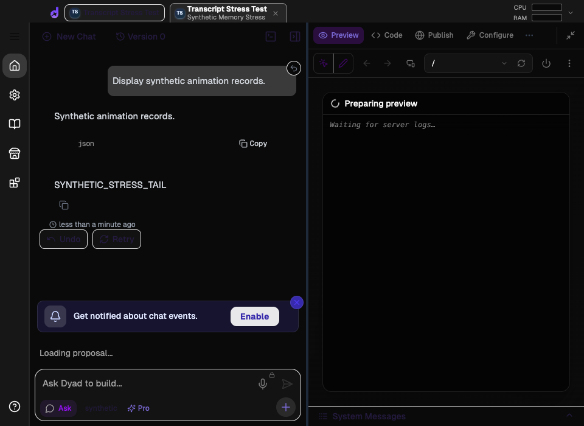

# Large assistant message memory probe

This manual macOS Electron probe loads one persisted assistant message containing
25,004,855 bytes of synthetic animation JSON (240,334 records) into Dyad's normal
chat route. It records process memory once per second and captures the app window
every 10 seconds for 120 seconds. It does not call a model or test streaming.

## Recorded observation

The checked-in artifacts were collected against commit `1be2b4b6d` using a freshly
packaged test build and a fresh profile with an explicitly synthetic OpenAI API
key to bypass provider setup. No real credential is supplied. Each record has only
`objectId`, `frame`, `x`, `y`, `rotation`, `scale`, and `opacity` fields.

| Renderer memory (Electron working set) |      MiB |
| -------------------------------------- | -------: |
| Before loading                         |   370.27 |
| Peak during the observation            | 8,671.67 |
| At the end of the observation          | 7,692.83 |

The provider setup panel is absent. In all 10–120 second captures, the assistant
introduction, JSON language/copy toolbar, and `SYNTHETIC_STRESS_TAIL` marker are
visible, but the code block shows no readable JSON records. “Loading proposal…”
and “Preparing preview / Waiting for server logs…” remain visible. All 11
completed renderer heartbeat checks exceeded their two-second timeout; the last
check was still pending at the end of the observation. No renderer crash event
was observed.



See [memory-samples.csv](memory-samples.csv) for the memory samples and
[summary.json](summary.json) for capture timing and heartbeat results. MiB values
come from Electron's `app.getAppMetrics().memory.workingSetSize`, converted from
KiB. They describe resident memory at each sample, not JavaScript heap size or a
measurement of leaked memory.

## Reproduce

With the repository's existing dependencies installed:

```sh
npm run build
node scripts/manual-tests/transcript-memory-stress.cjs
```

The script prints the fresh temporary artifact directory. It generates 100 JSON
files of approximately 250 KB, combines the records into one assistant message
inside a JSON code fence, and seeds only its own fresh test database. It starts
with a small assistant message, captures a baseline, replaces that message in the
database, and reopens the chat through Dyad's renderer and IPC flow. The generated
JSON, profile, memory samples, logs, and screenshots are retained after the test
instance closes. No application source files are changed.

The launch uses an explicit environment with no inherited provider credentials
and a dummy `OPENAI_API_KEY=sk-test-synthetic-no-network`,
an isolated profile and Git config, opted-out telemetry, disabled updates, a
nonfunctional loopback proxy, and a web-request blocker for HTTP(S) and WebSocket
traffic. Window capture uses `webContents.capturePage()` from Electron's main
process: it captured the compositor output even while renderer JavaScript
heartbeat checks timed out. The cadence starts when the large-chat route is
requested, with actual capture start times recorded in the report.

## Interpretation limits

- The dummy API key bypasses provider setup without making any model request.
  The synthetic app has no package manifest or Git repository;
  preview errors also occur in the baseline. This is not a clean
  end-to-end model conversation.
- Screenshots establish what was visible in this window, not that the entire
  message was absent from renderer state or that every part of the window was
  frozen. Heartbeat timeouts are separate evidence that renderer JavaScript was
  not responding promptly.
- The JSON code block did not become readable during the observation. There
  were no navigation-away, recovery, or post-GC measurements, and the root
  cause is not yet established. These artifacts document a reproduction, not a fix.
