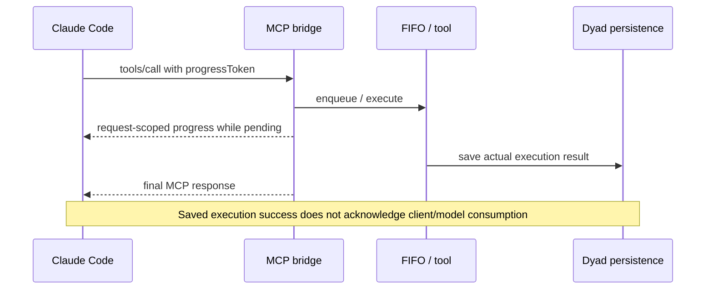

# Claude Code MCP progress and result delivery

## Progress routing

Dyad's Claude Code tool bridge creates a separate stateless MCP server for each
HTTP POST and rejects standalone GET/SSE connections. Progress notifications
must use the request handler's `extra.sendNotification(...)`, which supplies the
`relatedRequestId` needed to route them onto that tool call's POST response.
An unscoped `server.notification(...)` can instead target a nonexistent
standalone stream and be silently discarded.

The heartbeat starts when the bridge accepts a call, including time spent
waiting in the FIFO queue. UI tool status and build-output updates use a
separate channel and do not establish MCP progress delivery.

## Execution and client outcomes

Dyad emits host-generated tool results and persists them through the AI SDK.
Those results establish the execution outcome, not successful MCP response
delivery or the result Claude Code supplied to its model. Keep these outcomes
separate when diagnosing apparently contradictory saved results and narration.

Two client timeout paths need separate coverage:

- An SDK request timeout rejects the request and sends
  `notifications/cancelled`. The bridge routes this across POSTs to the original
  call. Cooperative tools stop waiting; cancelled queued calls are skipped.
- Claude Code's independent idle watchdog can reject a race without aborting
  the underlying SDK request. Execution and FIFO ownership then continue, and
  eventual responses can arrive after the client-facing outcome is settled.

Exact watchdog behavior and deadline values depend on the installed CLI
version and configuration. Confirm those values when investigating a new
report; an overall MCP deadline does not establish the idle deadline.

## Fix and regression evidence

Use request-scoped notifications while preserving the existing progress token,
heartbeat cadence, overall deadline, FIFO ownership, cancellation routing, and
same-request deduplication. Do not release the queue by forgetting unfinished
execution: that can overlap mutations and allow duplicate side effects.

These heartbeats establish bridge liveness, not advancing tool execution.
Delivered liveness heartbeats also keep the CLI idle watchdog waiting for a hung
tool. Noninteractive tools rely on their own execution deadlines; an unbounded
tool or FIFO wait can remain pending up to the overall MCP limit. The user must
use Stop to request cancellation of a stuck turn. Noncooperating work can
continue until physical settlement, retaining its FIFO ownership and cleanup.
A blanket bridge ceiling would also terminate intentional human waits.

The bridge regression holds execution on a controllable Promise and checks
that a real SDK client receives progress before the final response. The turn
integration regressions distinguish SDK cancellation from independently raced
idle abandonment, including late persisted success, skipped cancelled edits,
and successful queued edits after a caller abandons its wait.

See `src/ipc/services/claude_code/tool_bridge.test.ts` and
`src/ipc/services/claude_code/turn.integration.test.ts`. For future diagnosis,
correlate MCP request IDs, CLI tool-use IDs, and Dyad tool UUIDs across request
receipt, queue admission, execution, progress writes, cancellation, response
writes, and bounded CLI tool-result metadata. A successful write alone does
not establish model consumption.
